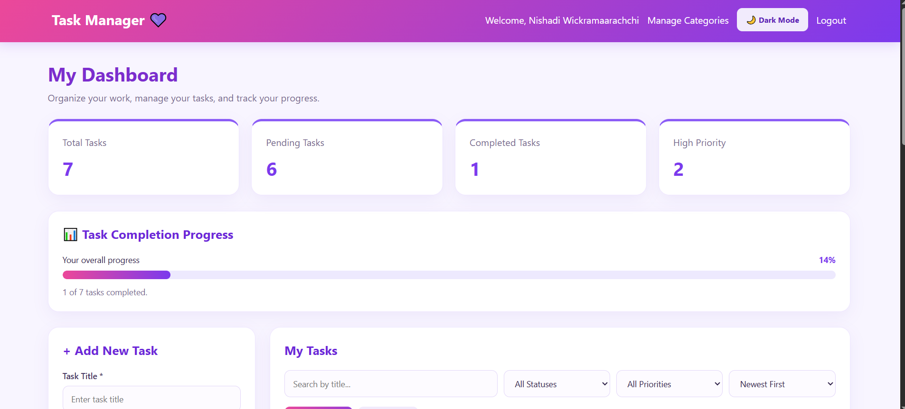
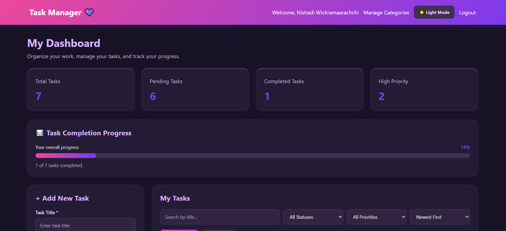
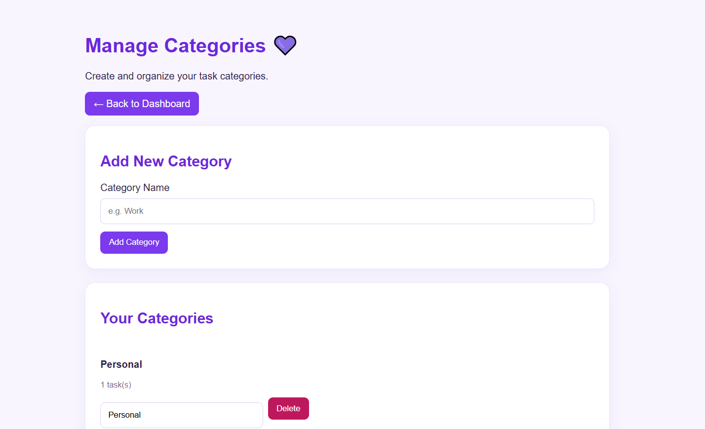

# 💜 Task Management System

A web-based task management application built with Laravel to help users organize tasks, manage priorities, track deadlines, and monitor their productivity.

## ✨ Features

- User registration, login, and logout
- Create, view, update, and delete tasks
- Organize tasks using categories
- Set task priorities and due dates
- Search, filter, sort, and paginate tasks
- Dashboard statistics
- Task completion progress bar
- Purple-themed responsive user interface
- Dark mode and light mode
- User-specific task management

## 📸 Screenshots

### ☀️ Light Mode Dashboard


### 🌙 Dark Mode Dashboard


### 💜 Manage Categories


## 🛠️ Technologies Used

- PHP
- Laravel
- MySQL / MariaDB
- Blade Templates
- HTML
- CSS
- JavaScript
- Git and GitHub

## ⚙️ Installation

1. Clone the repository:

   ```bash
   git clone https://github.com/Navodya52/laravel-task-management-system.git
   ```

2. Move into the project directory:

   ```bash
   cd laravel-task-management-system
   ```

3. Install PHP dependencies:

   ```bash
   composer install
   ```

4. Create the environment file:

   ```bash
   copy .env.example .env
   ```

5. Generate the application key:

   ```bash
   php artisan key:generate
   ```

6. Create a MySQL database named `task_management`.

7. Update the database settings in `.env`:

   ```env
   DB_CONNECTION=mysql
   DB_HOST=127.0.0.1
   DB_PORT=3306
   DB_DATABASE=task_management
   DB_USERNAME=root
   DB_PASSWORD=
   ```

8. Run the migrations:

   ```bash
   php artisan migrate
   ```

9. Install frontend dependencies:

   ```bash
   npm install
   npm run build
   ```

10. Start the Laravel development server:

    ```bash
    php artisan serve
    ```

11. Open `http://127.0.0.1:8000` in your browser.

## 🔐 Security

- Authentication for registered users
- Tasks associated with their owners
- Validation for task input
- Ownership checks for task operations

## 👩‍💻 Author

**Navodya Wickramaarachchi**

GitHub: [Navodya52](https://github.com/Navodya52)
